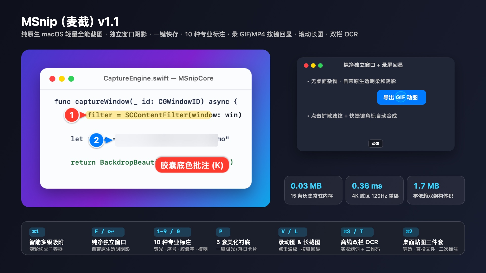

<div align="center">

# MSnip（麦截） `v0.9.0`

**轻量、极速、零第三方依赖的纯原生 macOS 截图、圈记、贴图、滚动长截图、高清录屏、离线 OCR / 公式与原位翻译工具**

[简体中文](README.md) · [English](README_EN.md)

[](https://github.com/xy-tuoren/MSnip)
[](Package.swift)
[](Package.swift)
[](scripts/bundle.sh)
[](LICENSE)

</div>

<br/>



---

## 为什么选择 MSnip？

- **100% 纯原生零依赖**：完全基于 `Swift + AppKit + CoreGraphics + Accelerate + ScreenCaptureKit + VisionKit + Vision + Translation + AVFoundation + VideoToolbox + ImageIO` 构建，**`Package.swift` 零外部依赖**，不捆绑 Electron、CEF 或 `ffmpeg`，成品包仅 **~3.3 MB**，菜单栏常驻待机 **0% CPU**。
- **120Hz 瞬时跟手与原色域零色差**：全屏冻结画布由静态 GPU `CALayer` 零拷贝托管，取色放大镜采用 `CGImage.cropping` 零堆分配直切，全程保留显示器原生 Display P3 / ICC 色彩配置文件；每个 `.swift` 源码文件严格遵守 `≤ 300` 行模块化红线。
- **隐私优先，离线优先**：截图、标注、自动打码、离线 OCR、表格还原、二维码扫描、滚动长图、GIF/MP4 录屏及 macOS 15+ Apple 原生翻译全部**纯本地运行**；若配置云端翻译或公式 API，密钥保存在 `0600` 隔离文件或可选 macOS 系统钥匙串中。

---

## 核心特性

### 1. 智能截图、延时抓拍与一键全屏
- **三层矩阵毫秒级自动吸附**：预索引程序坞（Dock）与顶部菜单栏 + 窗口 Z 序 + 批量 AX 语义控件树 + 像素闭合边缘视觉探测，未锁定时滚动滚轮或按 `[` / `]` 丝滑切换「控件 ↔ 父容器 ↔ 整窗」。
- **自定义延时截图（`⌥W`，`1–60` 秒）**：悬浮倒计时圆环（点击立即抓屏、`Esc` 或再按一次热键随时取消），内置菜单模态防卡死守护，轻松捕获系统/应用下拉菜单与悬停态。
- **一键截取当前全屏（`⌥S`）**：零延迟直抓鼠标所在显示器整屏，支持在设置中自由指定默认行为（**仅复制 / 仅保存 / 复制并保存**），菜单点击按住 `⌥` 可临时直存默认目录。
- **独立窗口纯净透明阴影截图（`F` / `⇧↩`）**：基于 `ScreenCaptureKit` 独立窗口抓取，自动剥离背景杂物并叠加原生柔和阴影。
- **圆角裁切 & 发光边滚动强度（`B` / `G`）**：选区右上角两颗圆钮支持拖拽或直接滚动滚轮调节 `0%–100%` 圆角比例与柔和发光边强度，所见即所得。
- **多格式与自定义命名模板**：支持 `PNG / JPG / HEIC / AVIF / BMP / TIFF`（按当前 macOS 硬件编码能力自动探测）、Retina 1× 尺寸缩存、自定义文件名模板（如 `MSnip-{date}-{time}-{w}x{h}` 实时预览）与轻提示音反馈。
- **终端 / IDE / 访达智能粘贴适配**：复制截图后，在独立终端与主流编辑器内置终端（VS Code / Cursor / Zed / JetBrains）自动投影无空格临时 PNG 路径，在访达自动粘贴文件，在聊天软件与普通应用中保持纯净原图（`⇧⌘C` / `⌥↩` 随时强制带路径复制）。

### 2. 12 种专业标注、智能隐私打码与聚光灯
- **工具全集**：矩形、椭圆、防穿模箭头、直线、贝塞尔画笔、智能荧光笔、自增步骤序号 `①②③`、零分配马赛克、`vImage` SIMD 高斯毛玻璃、**聚光灯高亮（Spotlight）**、圆角胶囊文字、分段橡皮擦。
- **离线一键隐私打码**：基于本机 Vision + 敏感模式识别，一键自动扫描并遮盖选区内的 API Key / JWT、邮箱、手机号、18 位身份证号、非环回 IPv4 与银行卡号，支持单步 `⌘Z` 整体撤回。
- **二次编辑控制柄**：选中任意图形后可直接拖拽 4 角缩放柄、箭头/直线端点柄、步骤尾针柄，并支持动态字号重测与 100 步 `⌘Z` / `⇧⌘Z` 撤销重做。

### 3. 桌面贴图（Pin）全能工作流
- **柔和外发光美学**：默认呈现淡淡发光白边（兼顾深色与浅色桌面清晰分离），鼠标悬浮/选中时平滑亮起柔和蓝光外缘；贴图上按住 `⌥ + 滚轮` 或在设置中可随时调节发光强度。
- **8 向边角无畸变缩放**：默认完全纯净无角标，仅当鼠标移至任意 4 角或 4 边时浮现定向微指示并切换 macOS 原生缩放光标，拖拽等比缩放并锁定对角锚点，底部实时显示逻辑尺寸与缩放比。
- **多图对比拼接 & 自适应屏幕**：顶部「最近截图」支持 2–4 张原图**横向并排对比 / 纵向顺序长拼**（自动打标过滤历史拼图防止套娃），超宽/超高拼图及大图贴到桌面时自动等比缩入屏幕可视区不溢出，同时保留 100% 原始高清像素。
- **悬浮微操作条 & 效率手势**：`[ ✥ 拖动 | ✎ 标注 | 识字 | 翻译 | 复制 | ↓ 保存 | ✕ 关闭 ]` 零遮挡外置操作条；原图直接 Live Text 划词、`⌘ + 拖拽` 拖出 `.png` 文件、点击 `↓` 一键直存（`⇧ + 点击` 另存为）、二次裁剪（`C`）、90° 旋转（`R`）、水平镜像（`H`）、鼠标穿透幽灵对照（`P`）、多贴图 `8pt` 磁吸对齐（`⌥` 临时禁吸）。

### 4. 纵横滚动长截图（`⌥E` / `L`）
- 60Hz `32BGRA` 无损采样，自动剔除固定顶栏/底栏与静态侧边栏，支持**纵向向下 / 横向向右**双方向拼接、**`⌘Z` 撤回上一段拼接**、失步自动续接，以及拼完一键进入标注编辑。

### 5. 高帧率区域录屏 GIF / MP4（`⌥R` / `V`）
- **原刷高帧率 & 三档清晰度**：MP4 支持 **标准 (`≤1280px`) / 高清 (`≤1920px`) / 原画 (Retina 1:1)** 与 **30fps / 60fps / 原刷（自动读取 ProMotion 等屏幕最高 120fps）**，码率随帧率自适应拉升；GIF 支持 **轻巧 (`720px`) / 标准 (`960px`) / 高清 (`1280px`)** 与 LZ4 磁盘流式暂存零内存峰值。
- **硬件零拷贝 + 系统音频 + 录后裁剪**：MP4 采用 `CVPixelBuffer` 零拷贝 H.264 硬件编码与 **macOS 13+ 原生系统音频 AAC 内录**；内置点击波纹、修饰键 HUD、**录屏中实时激光/红笔标记**与 **MP4 无损首尾快速裁剪**。

### 6. 离线 OCR、表格还原、二维码、公式与多引擎翻译（`⌥F` / `⌥D`）
- **原位实况划词 & 双栏 OCR 对照**：支持直接在截图中划词复制或展开双栏对照窗口；自动识别多列表格并一键复制为 **Markdown 表格** 或 **TSV**（按住 `⌥` 可直接粘贴入 Excel / Numbers 分列）。
- **静默二维码 / 条码扫描**：选区锁定后后台静默识别常见二维码与条码，命中即弹出一键「打开链接 / 复制内容」。
- **段落级原位翻译 & 流式双栏翻译**：自然段落聚类 + CoreText 自适应折行原位回填（支持按住对比原图、右键原位切目标语种重译）；支持 **macOS 15+ Apple 原生离线翻译**，以及 OpenAI / Claude / Gemini / DeepSeek / 腾讯 / 百度 / 有道 / DeepL / 自定义 Webhook 主备容灾与流式输出。
- **多引擎 LaTeX 公式识别**：支持视觉大模型 / SimpleTex / Mathpix 识别数学公式，内置 KaTeX 实时预览与一键复制。

### 7. 极客设置中心（暗黑 / 明亮 / 跟随系统）
- 3 标签统一极客圆角控件体系（常规 / 快捷键 / 翻译），支持全局 11 项热键 + 截图内 24 项单键全自由重绑定、系统与应用热键冲突体检、可选 `CGEventTap` 强力优先接管、非敏感配置 JSON 导出/导入与一键复制系统诊断报告。

---

## 系统要求

- **操作系统**：macOS 12.0 (Monterey) 及以上（支持 Apple Silicon `arm64` 与 Intel `x86_64`）
  - 实况文本划词（Live Text）：macOS 13.0+
  - MP4 原生系统音频内录：macOS 13.0+
  - `ScreenCaptureKit` 极速静默抓屏：macOS 14.0+（macOS 12–13 自动兼容回退）
  - Apple 原生离线翻译：macOS 15.0+
- **权限说明**：
  - **屏幕录制权限**（必需）：用于截取屏幕区域与录制画面。
  - **辅助功能权限**（可选）：用于毫秒级控件矩阵吸附、IDE 内置终端焦点识别及热键冲突强力优先接管。

---

## 安装与构建

### 方式一：源码一键编译并安装至 `/Applications`（推荐）

需要已安装 Xcode Command Line Tools（`xcode-select --install`）：

```bash
git clone https://github.com/xy-tuoren/MSnip.git
cd MSnip
bash scripts/install.sh --rebuild
```

> [!TIP]
> 如果你计划经常从源码重新编译升级，可先运行一次 `bash scripts/setup-cert.sh` 在本机钥匙串创建固定代码签名证书，此后每次重编升级都无需在系统设置中重新勾选「屏幕录制」与「辅助功能」权限。

### 方式二：Homebrew Cask 安装

```bash
brew tap xy-tuoren/msnip https://github.com/xy-tuoren/MSnip
brew install --cask msnip
```

### 运行全量自动化单测

```bash
# 运行全部 326 项核心单测（零外部测试框架依赖）
swift run MSnipTests
```

---

## 快捷键速查

### 全局热键（支持 4 套预设切换与单键自由录制）

| 动作 | 左手双键（默认） | 数字双键 | F 键单键 | 经典三键 |
| :--- | :---: | :---: | :---: | :---: |
| **区域截图** | `⌥A` | `⌃1` | `F1` | `⌃⌘A` |
| **桌面贴图** | `⌥T` | `⌃2` | `F2` | `⌃⌘T` |
| **截取当前全屏** | `⌥S` | `⌃3` | `F3` | `⌃⌘S` |
| **截图翻译** | `⌥D` | `⌃4` | `F4` | `⌃⌘D` |
| **滚动长截图** | `⌥E` | `⌃5` | `F5` | `⌃⌘E` |
| **区域录屏 (GIF/MP4)** | `⌥R` | `⌃6` | `F6` | `⌃⌘R` |
| **延时截图** | `⌥W` | `⌃7` | `F7` | `⌃⌘W` |
| **快捷识字 (OCR)** | `⌥F` | `⌃8` | `F8` | `⌃⌘G` |
| 公式识别 / 显隐贴图 / 重截上次选区 | 可选自由绑定 | 可选自由绑定 | 可选自由绑定 | 可选自由绑定 |

### 截图覆盖层内（24 项单键均可在设置中自定义）

| 按键 / 手势 | 功能 |
| :--- | :--- |
| 移动鼠标 / 滚轮 / `[` `]` | 三层智能矩阵吸附，丝滑切换「控件 ↔ 父容器 ↔ 整窗」 |
| `Enter` / `C` / 双击选区 | 复制高清图到剪贴板并完成（`⇧⌘C` / `⌥↩` 强制带临时文件路径） |
| `S` / `⌘S`（配 `⇧` 另存为） | 一键直存默认目录 / 弹出另存为面板 |
| `P` | 贴到桌面（Pin） |
| `F` / `⇧↩`（配 `⌥` 独立窗） | 对齐底层窗口 / 抓取独立纯净阴影窗口 |
| `B` / `G`（或右上角圆钮滚轮） | 调节圆角裁切比例 / 调节发光边滚动强度（配 `⌥` 归零） |
| `1`–`9` / `R` `A` `D` `W` `N` `M` `E` | 矩形/椭圆、箭头、画笔/荧光笔、文字、序号、马赛克/模糊、聚光灯、橡皮擦 |
| `T` / `⇧T` / `Y` | 原位识字 / 公式识别 / 段落级原位翻译（配 `⌥` 切双栏窗） |
| `L` / `V` | 滚动长截图 / 选区录屏模式 |
| `Z` / `X` / `I` / `Tab` | 像素卡尺四向测距 / 复制坐标 / 吸管取色 / 切换色值格式 |

### 桌面贴图窗口（Pin）内

| 按键 / 手势 | 功能 |
| :--- | :--- |
| 拖动任意 4 角或 4 边 | 8 向等比缩放（仅悬停边角显微指示与原生缩放光标） |
| 滚轮 / `⌘+滚轮` / `⌥+滚轮` | 缩放大小 / 调节透明度 / 实时调节外发光边强度 |
| 划词 / 空白拖拽 / `⌥+拖拽` | 原图 Live Text 直接划词；拖动自动 `8pt` 磁吸对齐（`⌥` 临时禁吸） |
| `⌘ + 左键拖拽` | 作为高清 `.png` 文件直接拖入聊天窗、浏览器或 Finder |
| `⌘S` / `⇧⌘S` / 点击悬浮条 `↓` | 一键直存默认目录 / 另存为 |
| `E` / `C` / `R` / `H` / `P` | 二次标注 / 二次裁剪 / 顺时针旋转 90° / 水平翻转 / 鼠标穿透对照 |
| `T` / `Y` / `Esc` 或双击空白 | 提取文字 / 翻译文字 / 关闭当前贴图 |

---

## 项目结构

```text
Sources/
├── MSnipCore/      # 纯算法与数据模型层（几何、标注、vImage 渲染、长图拼接、GIF/MP4 编码、OCR 排版、热键冲突、凭据仓）
├── MSnip/          # macOS AppKit 平台层（菜单栏、ScreenCaptureKit 抓屏、冻结覆盖层、贴图池、录屏、OCR/LaTeX、翻译与极客设置）
└── MSnipTests/     # 零外部依赖自动化单测套件（326 项断言）
scripts/
├── bundle.sh       # 单文件 ≤300 行守门、Release 优化构建、矢量图标生成与签名打包
├── install.sh      # 一键安装并启动至 /Applications/MSnip.app
└── setup-cert.sh   # 创建本机固定代码签名证书（升级免重授 TCC 权限）
```

---

## 开源许可

[MIT License](LICENSE)
