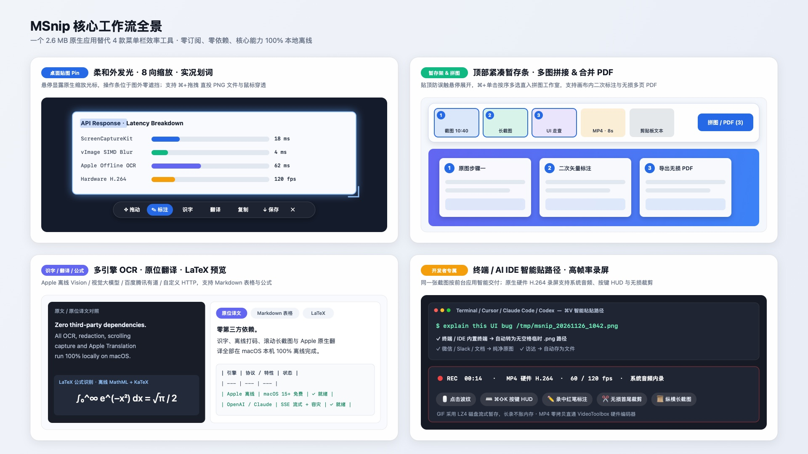

<div align="center">

# MSnip（麦截）

### 3 MB 以内的纯原生 macOS 截图 · 标注 · 贴图 · 录屏 · OCR / 翻译工具

**本机原生仅 `2.6 MB`（Zip `1.3 MB`）、零第三方依赖、待机 `0%` CPU、用完即释放全屏位图——集 12 种标注、离线隐私打码、桌面贴图、顶边暂存架、纵横长图、高帧率录屏、多引擎 OCR / 公式与原位翻译于一身，MIT 开源免费、无订阅。**

<p align="center">
  <a href="https://github.com/xy-tuoren/MSnip/releases"></a>
  <a href="https://github.com/xy-tuoren/MSnip/actions/workflows/ci.yml"></a>
  <a href="https://github.com/xy-tuoren/MSnip/stargazers"></a>
  
  
  
  
  <a href="LICENSE"></a>
</p>

**简体中文** · [English](README_EN.md)

**[为什么选 MSnip](#-为什么选-msnip) · [横向对比](#-横向对比) · [性能红线](#-性能红线实测口径) · [界面预览](#-界面与实景预览) · [核心功能](#-核心功能一览) · [快速安装](#-快速安装) · [快捷键](#-快捷键速查) · [工程架构](#-工程架构与测试)**

</div>

<br/>


*按下 `⌥A` 后的实景体验：冻结当前屏幕、智能吸附窗口与控件、双层极简悬浮工具栏、一键离线打码 API Key / 手机号 / 邮箱、右上角实时调节圆角与外发光，以及零拷贝 15×7 像素放大镜。*

---

## 为什么选 MSnip？

许多 macOS 用户为了凑齐日常截图与视觉效率，不得不在菜单栏同时常驻 3–4 款软件（截图 + 贴图 + 录屏/长图 + OCR/翻译），或者为闭源商业套件按年付费；还有不少跨平台工具套着 Electron / Qt / 内嵌 `ffmpeg`，动辄上百 MB 且常驻吃内存。

**MSnip 想把「极致轻量」和「专业全能」同时做到位**：零第三方库，纯原生 Swift 编写，本地原生构建仅 **2.6 MB**，既能一台顶四台，又 100% 开源可审计。

- **一台顶四台，开源且克制**：覆盖截图、12 种标注、离线隐私打码、桌面贴图、顶边暂存架、多图拼接/合并 PDF、纵横长截图、高帧率 GIF/MP4 录屏（含系统音频）、多引擎 OCR/表格还原、LaTeX 公式与原位翻译；MIT 开源、无账号登录、无水印、无付费墙。
- **为开发者与 AI 编程工作流量身打造**：
  - **终端与 AI IDE 智能贴路径**：复制截图后，粘贴到独立终端或 VS Code / Cursor / Zed / JetBrains 内置终端（及 Claude Code / Codex 等 CLI 助手）时自动转为无空格临时 `.png` 路径；粘贴到微信 / Slack / 文档仍是纯净原图，粘贴到访达自动变为文件。
  - **离线一键隐私打码**：本机 Vision 扫描选区内的 API Key / JWT、邮箱、手机号、18 位身份证号、非环回 IPv4 与银行卡号，一键马赛克/毛玻璃遮盖且支持 `⌘Z` 整体撤回。
  - **表格一键还原 Markdown / TSV**：截取多列表格直接复制为 Markdown 表格或 Excel / Numbers 分列数据。
- **隐私可控，核心能力 100% 本地离线**：截图工具拥有系统最高级别的「屏幕录制」权限。MSnip 全程源码透明，截图、标注、打码、OCR、二维码扫描、长图拼接、录屏及 macOS 15+ Apple 原生翻译全部本机离线完成；若按需配置云端翻译或公式服务，API 密钥严格隔离存储于 `0600` 本地文件或 macOS 系统钥匙串。

---

## 横向对比

> 以下对比基于各工具公开特性与常见版本表现整理，力求客观反映定位差异。

| 能力维度 | macOS 自带 | Shottr | Snipaste | CleanShot X | PixPin | **MSnip（麦截）** |
| :--- | :---: | :---: | :---: | :---: | :---: | :---: |
| **开源与价格** | 系统内置 | 免费 / 付费 Pro（闭源） | 免费 / 付费 Pro（闭源） | $29 买断 + 续费（闭源） | 免费 / 会员（闭源） | **永久免费 · MIT 开源** |
| **技术栈与依赖** | 系统内置 | 原生 Swift | Qt / C++ | 原生 Swift + 闭源组件 | Qt / C++ + 外部引擎 | **纯原生 Swift · 0 第三方依赖** |
| **应用体积** | 系统内置 | ~10 MB | ~55 MB | ~50+ MB | ~120+ MB | **原生 `2.6 MB`（双架构 `6.0 MB`）** |
| **标注与一键隐私打码** | 基础标注 | 丰富标注 | 丰富标注 | 丰富 + 手动打码 | 丰富标注 | **12 种标注 + 离线自动识别打码** |
| **桌面贴图（Pin）** | 不支持 | 仅单图置顶 | 强贴图（基础框） | 支持 | 强贴图 | **柔和发光边 + 8 向缩放 + Live Text + 穿透** |
| **顶边暂存架 & 拼图/PDF** | 不支持 | 不支持 | 不支持 | 不支持 | 不支持 | **98pt 紧凑暂存条 + 多图拼接 + 合并 PDF** |
| **纵横滚动长截图** | 不支持 | 仅纵向 | 不支持 | 仅纵向 | 支持 | **纵 / 横双向 + 撤回上一段 + 剔除固定栏** |
| **高帧率录屏 + 系统音频** | 基础录屏 | 不支持 | 不支持 | 支持（付费） | 支持（GIF/录屏） | **高帧率硬件 H.264 + 系统音频 + 录中标记 + 无损裁剪** |
| **OCR / 表格 / 原位翻译 / LaTeX** | 仅预览选字 | 离线 OCR | 不支持 | 离线 OCR | OCR + 贴图翻译 | **6 类 OCR + Markdown 表格 + 原位/流式翻译 + LaTeX** |
| **终端 / AI IDE 智能贴路径** | 不支持 | 不支持 | 不支持 | 不支持 | 不支持 | **按前台应用自动切换（终端贴路径 / 聊天贴原图）** |

---

## 性能红线（实测口径）

| 指标 | 实测表现 | 工程实现说明 |
| :--- | :--- | :--- |
| **原生应用体积（`arm64`）** | **`2.6 MB`**（Zip **`1.3 MB`**） | `scripts/bundle.sh` 实测 `2,696 KB`（红线守门 `≤ 3.0 MiB`） |
| **双架构通用包（Universal）** | **`6.0 MB`**（Zip **`2.8 MB`**） | `arm64 + x86_64` 双切片通用二进制（GitHub Releases & Homebrew） |
| **应用图标（`AppIcon.icns`）** | **`64 KB`** | 纯 CoreGraphics 矢量绘制 + 5 滤镜最优 `zlib-9` + 8 切片 `sRGB` |
| **待机 CPU 占用** | **`0.0%`** | 纯事件驱动，无后台定时轮询 |
| **会话内存零驻留** | **用完即清** | 退出截图/录屏/预览立即释放全屏 `CGImage`、切片缓存与 WebKit 子进程 |
| **覆盖层重绘与放大镜** | **高刷满帧跟手** | GPU 静态图层 + 局部脏矩形增量刷新 + 零冗余拷贝像素采样 |
| **高帧率录屏编码** | **60 / 120 fps** | MP4 直通 VideoToolbox 硬件 H.264 零拷贝；GIF 采用 LZ4 磁盘流式暂存防爆内存 |
| **色彩与 Retina 精度** | **Display P3 原生** | 逻辑点交互与物理像素导出严格分离，全链路保留屏幕 ICC 色彩配置 |

**为什么能压到 `2.6 MB` 且不牺牲功能与安全？**
1. **零第三方依赖**：不捆绑 Electron、WebView 壳、Qt 或 `ffmpeg`，全部直调 macOS 原生 `AppKit`、`ScreenCaptureKit`、`Accelerate/vImage`、`Vision`、`VideoToolbox` 与 `Translation`。
2. **现代编译与链接裁剪**：Release 构建启用 `-Osize` + `-cross-module-optimization` + **单 LLVM 单元合并**（`-enable-single-module-llvm-emission`，让 LLVM 跨文件全局执行指令合并与外提）+ 仅导出 `_main`（削减 `LC_DYLD_EXPORTS_TRIE` 165 KB），同时**完整保留 Swift 反射元数据**确保 SwiftUI / Translation / VisionKit 100% 稳定。
3. **纯矢量高压缩图标**：放弃数百 KB 的栅格原图，使用 [generate-icon.swift](scripts/generate-icon.swift) 直接生成全分辨率锐利的 `64 KB` 标准 `sRGB` `.icns`。

---

## 适合谁？

- **开发者与 AI 编程重度用户**：截完图切回 Terminal / Cursor / Claude Code / Codex 按 `⌘V` 直接粘贴无空格文件路径；发报错截图前一键离线打码 API Key / 邮箱 / 手机号。
- **产品经理、设计师与技术作者**：12 种高颜值标注、自增步骤序号 `①②③`、圆角发光边、纯净独立窗口阴影、多图拼接与无损多页 PDF，一套工具直出配图。
- **重度阅读与跨语种办公用户**：段落级原位翻译（macOS 15+ Apple 离线免费 + 全协议大模型流式）、多引擎 OCR、Markdown 表格还原与 LaTeX 公式识别。
- **反感臃肿与订阅的极简效率党**：一个 `2.6 MB` 原生应用替代 3–4 款菜单栏常驻工具，源码透明可自编译、可固定本地签名免掉权限。

---

## 界面与实景预览

### 核心工作流全景（桌面贴图 · 顶边暂存架 · OCR / 翻译 / LaTeX · 开发者专属）



### 极客设置中心（真实运行窗口截图 · 4 标签零横向滚动条）

<p align="center">
  
</p>

*所有偏好收口于「通用 / 快捷键 / 识字与翻译 / 模型与服务」四栏，原生适配浅色与深色模式，修改即生效自动保存，支持密钥钥匙串加密存储与脱敏 JSON 一键迁移。*

---

## 核心功能一览

### 1. 精准截图、延时抓拍与一键全屏
- **智能多级吸附**：自动识别程序坞、菜单栏、窗口层、UI 控件与闭合视觉边缘；锁定前滚动滚轮或按 `[` / `]` 在「控件 ↔ 父容器 ↔ 整窗」间顺滑切换。
- **自定义延时截图（`⌥W`，`1–60` 秒）**：悬浮倒计时圆环（点击立刻抓屏，`Esc` 取消），内置系统菜单防卡死保护，轻松捕获下拉菜单与悬停态。
- **一键截取当前全屏（`⌥S`）**：直接截取鼠标所在显示器，默认动作可在设置中自由切换（**仅复制 / 仅保存 / 复制并保存**）。
- **纯净独立窗口（`F` / `⇧↩`）**：剥离桌面背景杂物，导出带 macOS 原生透明柔和阴影的单窗图。
- **圆角裁切 & 外发光强度（`B` / `G`）**：选区右上角双圆钮支持拖拽或滚轮实时调 `0%–100%` 圆角与外发光。
- **多格式导出与模板命名**：自动探测本机支持的 `PNG / JPG / HEIC / AVIF / BMP / TIFF`，支持 Retina 1× 缩存、自定义文件名模板（如 `MSnip-{date}-{time}-{w}x{h}`）与截后悬浮速览卡。

### 2. 12 种标注工具、聚光灯与离线一键隐私打码
- **标注全集**：矩形、椭圆、箭头、直线、贝塞尔画笔、智能荧光笔、自增步骤序号 `①②③`、马赛克、SIMD 高斯毛玻璃、**聚光灯高亮（Spotlight）**、圆角胶囊文字、分段橡皮擦。
- **离线一键打码**：本机 Vision 识别 API Key / JWT、邮箱、手机号、18 位身份证号、非环回 IPv4 与银行卡号并自动遮盖，`⌘Z` 一步撤回。
- **二次编辑、克隆与 100 步撤销**：点选任意标注即可拖控制柄微调；支持 **`⌘C` / `⌘V` 复制粘贴**与 **`⌘D` 原地克隆**（序号自动递增），100 步 CoW 快照撤销/重做栈。

### 3. 桌面贴图（Pin）、顶部轻暂存架（Shelf）与多图拼接 / PDF 工作室
- **顶部紧凑暂存条（MSnip Shelf）**：支持**悬停展开**（贴顶 `≤ 1.5pt` 停留 `0.55s` 防误触、拖文件到顶边 `80ms` 秒弹）、**快捷键切换**与**常驻显示**；`98pt` 紧凑高度，同屏展示多达 9 张卡片，支持点击复制、`✎` 二次标注、`⌘ + 单击` 按序多选拼图与拖出分享。菜单栏图标支持**左键/右键展开完整功能菜单，`⌥ + 左键` 一键显隐暂存架**。
- **桌面贴图**：柔和白/蓝外发光边框、`0%–100%` 连续光晕滑条双向同步、8 向边角纯净缩放、原图 Live Text 划词、`⌘ + 拖拽` 直投 `.png` 文件、鼠标穿透对照（`P`）、多贴图 `8pt` 磁吸对齐，以及零遮挡图外悬浮条。
- **多图拼接与合并 PDF 工作室**：支持自由拖入/排序、**画布内直接二次标注**，提供**「拼成一张图」**（横/纵/2–4 列网格、画幅预设、间距/圆角/阴影/2D 色盘吸管/渐变/透明底色、序号与水印）与**「合并多页 PDF」**双模式。

### 4. 纵横滚动长截图（`⌥E` / `L`）与高帧率录屏（`⌥R` / `V`）
- **纵横滚动长截图**：无损实时采样，自动剔除固定顶栏/底栏/静态侧边栏，支持**纵向向下 / 横向向右**双方向、**`⌘Z` 撤回上一段**与失步自愈。
- **高帧率 GIF / MP4 录屏**：MP4 支持 **标准 / 高清 / 原画 (Retina 1:1)** 及 **30fps / 60fps / 跟随屏幕高帧率**、**macOS 13+ 系统音频内录**、点击波纹、快捷键 HUD、**录中实时红笔标注**与 **MP4 无损首尾裁剪**；GIF 支持 **轻巧 / 标准 / 高清** 三档。

### 5. 多引擎翻译、OCR（离线 + 云端 + 视觉大模型）与 LaTeX 公式（`⌥D` / `⌥F`）
- **段落级原位翻译 & 流式双栏翻译**：支持 **macOS 15+ Apple 原生离线翻译**，以及 **OpenAI Chat / OpenAI Responses (`/v1/responses`) / Anthropic Messages / Gemini Native** 四大协议（自动过滤推理思考块）与 DeepSeek / 智谱 / 通义 / 豆包 / Kimi / 腾讯 / 百度 / 有道 / DeepL / Ollama / 自定义中转主备容灾。
- **三模式识字与 6 类 OCR 引擎**：支持**原位划词 / 双栏对照 / 静默直拷**；除 **Apple 离线 Vision** 外支持**视觉大模型 / 百度 / 腾讯 / 有道 / 自定义 HTTP 通用适配**（兼容 Umi-OCR / PaddleOCR / RapidOCR），表格一键转 **Markdown / TSV**，内置静默二维码/条码识别。
- **LaTeX 公式识别**：支持视觉大模型 / SimpleTex / Mathpix / 离线基础识别，内置离线原生 WebKit MathML 即时渲染与在线 KaTeX 精排预览。

### 6. 命令行与 `msnip://` URL Scheme 联动
- 原生适配 Raycast / Alfred / Apple 快捷指令 / Shell 脚本：支持 `open msnip://capture`、`msnip://translate`、`msnip://ocr`、`msnip://silent-ocr`、`msnip://shelf`、`msnip://long`、`msnip://record`、`msnip://pin`、`msnip://settings`，以及 `MSnip --enter=ocr|shelf|long|video|pin` 单实例快传。

---

## 快速安装

### 系统要求
- **macOS 12.0 (Monterey) 及以上**（Apple Silicon `arm64` & Intel `x86_64`）
  - 实况文本划词（Live Text）、MP4 系统音频内录：macOS 13.0+
  - `ScreenCaptureKit` 极速静默抓屏：macOS 14.0+（macOS 12–13 自动回退）
  - Apple 原生离线翻译：macOS 15.0+
- **系统权限**：**屏幕录制**（必需，用于抓屏与录屏）；**辅助功能**（可选，用于控件吸附、IDE 内置终端识别及热键冲突接管）。

### 方式一：源码一键编译原生极致瘦身版（推荐，仅 `2.6 MB`）

需安装 Xcode Command Line Tools（`xcode-select --install`）：

```bash
git clone https://github.com/xy-tuoren/MSnip.git
cd MSnip
bash scripts/install.sh --rebuild
```

> [!TIP]
> 若经常拉取最新源码重编，先运行一次 `bash scripts/setup-cert.sh` 在本机钥匙串生成固定自签名证书，此后每次升级均无需在系统设置中重新授予「屏幕录制」与「辅助功能」权限。

### 方式二：GitHub Releases 直接下载（Universal 双架构）

前往 **[GitHub Releases](https://github.com/xy-tuoren/MSnip/releases)** 下载 `MSnip-v*-macOS.zip`，解压后拖入 `/Applications` 即可。

### 方式三：Homebrew Cask

```bash
brew tap xy-tuoren/msnip https://github.com/xy-tuoren/MSnip
brew install --cask msnip
```

---

## 快捷键速查

### 全局热键（内置 4 套预设 + 冲突扫描与自由录制）

| 动作 | 左手双键（默认） | 数字双键 | F 键单键 | 经典三键 |
| :--- | :---: | :---: | :---: | :---: |
| **区域截图** | `⌥A` | `⌃1` | `F1` | `⌃⌘A` |
| **桌面贴图** | `⌥T` | `⌃2` | `F2` | `⌃⌘T` |
| **截取当前全屏** | `⌥S` | `⌃3` | `F3` | `⌃⌘S` |
| **截图翻译** | `⌥D` | `⌃4` | `F4` | `⌃⌘D` |
| **滚动长截图** | `⌥E` | `⌃5` | `F5` | `⌃⌘E` |
| **区域录屏 (GIF/MP4)** | `⌥R` | `⌃6` | `F6` | `⌃⌘R` |
| **延时截图** | `⌥W` | `⌃7` | `F7` | `⌃⌘W` |
| **快捷识字 (OCR)** | `⌥F` | `⌃8` | `F8` | `⌃⌘G` |
| **顶部暂存架** | `⌥Q` | `⌃9` | `F9` | `⌃⌘K` |
| 公式识别 / 显隐贴图 / 重截上次选区 | 可选自由绑定 | 可选自由绑定 | 可选自由绑定 | 可选自由绑定 |

<details>
<summary><b>展开查看：截图覆盖层与桌面贴图（Pin）全部快捷键</b></summary>

#### 截图覆盖层内（24 项单键均可在设置中自定义）

| 按键 / 手势 | 功能 |
| :--- | :--- |
| 移动鼠标 / 滚轮 / `[` `]` | 智能吸附并在「控件 ↔ 父容器 ↔ 整窗」间切换 |
| `Enter` / `C` / 双击选区 | 复制高清图到剪贴板并完成（`⇧⌘C` / `⌥↩` 强制带临时文件路径） |
| `S` / `⌘S`（配 `⇧` 另存为） | 一键直存默认目录 / 弹出另存为面板 |
| `P` | 贴到桌面（Pin） |
| `F` / `⇧↩`（配 `⌥` 独立窗） | 对齐底层窗口 / 抓取独立纯净阴影窗口 |
| `B` / `G`（或右上角圆钮滚轮） | 调节圆角裁切比例 / 调节发光边强度（配 `⌥` 归零） |
| `1`–`9` / `R` `A` `D` `W` `N` `M` `E` | 矩形/椭圆、箭头、画笔/荧光笔、文字、序号、马赛克/模糊、聚光灯、橡皮擦 |
| `T` / `⇧T` / `Y` | 原位识字 / 公式识别 / 段落级原位翻译（配 `⌥` 切双栏窗） |
| `L` / `V` | 滚动长截图 / 选区录屏模式 |
| `Z` / `X` / `I` / `Tab` | 像素卡尺四向测距 / 复制坐标 / 吸管取色 / 切换色值格式 |

#### 桌面贴图窗口（Pin）内

| 按键 / 手势 | 功能 |
| :--- | :--- |
| 拖动任意 4 角或 4 边 | 8 向等比缩放（仅悬停边角显微指示与原生缩放光标） |
| 滚轮 / `⌘+滚轮` / `⌥+滚轮` | 缩放大小 / 调节透明度 / 实时调节外发光边强度 |
| 划词 / 空白拖拽 / `⌥+拖拽` | 原图 Live Text 直接划词；拖动自动 `8pt` 磁吸对齐（`⌥` 临时禁吸） |
| `⌘ + 左键拖拽` | 作为高清 `.png` 文件直接拖入聊天窗、浏览器或访达 |
| `⌘S` / `⇧⌘S` / 点击悬浮条 `↓` | 一键直存默认目录 / 另存为 |
| `E` / `C` / `R` / `H` / `P` | 二次标注 / 二次裁剪 / 顺时针旋转 90° / 水平翻转 / 鼠标穿透对照 |
| `T` / `Y` / `Esc` 或双击空白 | 提取文字 / 翻译文字 / 关闭当前贴图 |

</details>

---

## 工程架构与测试

MSnip 在代码层面坚持内聚模块化与零第三方依赖：全库共 **111 个 `.swift` 文件**，CI 强制守门单文件 `≤ 800` 行，核心算法与 AppKit 界面层彻底解耦，并自带零外部框架依赖的自动化单测套件（**414 项核心断言**）。

```bash
swift build                             # Debug 编译检查
swift run MSnipTests                    # 运行全部 414 项核心单元测试
bash scripts/bundle.sh                  # 构建本机单架构极致瘦身包（2.6 MB）
bash scripts/bundle.sh --universal      # 构建双架构通用二进制（发版用，6.0 MB）
```

```text
Sources/
├── MSnipCore/      # 纯算法与数据模型层（几何、12 种标注、vImage SIMD 渲染、长图拼接、GIF/MP4 编码、OCR/敏感字段探测、热键与凭据仓）
├── MSnip/          # macOS AppKit 平台层（菜单栏、ScreenCaptureKit 抓屏、冻结覆盖层、贴图池、暂存架、拼图、录屏、OCR/LaTeX、翻译与设置）
└── MSnipTests/     # 零外部依赖自动化单测套件（414 项核心断言）
scripts/
├── bundle.sh       # ≤800 行护栏、Release -Osize 单单元 LLVM 构建、体积红线守门与签名打包
├── generate-icon.swift  # 零依赖纯矢量 sRGB AppIcon.icns 生成器（64 KB）
├── install.sh      # 一键安装并启动至 /Applications/MSnip.app
└── setup-cert.sh   # 创建本机固定代码签名证书（升级免重授 TCC 权限）
```

---

<div align="center">

### Star History

<a href="https://www.star-history.com/#xy-tuoren/MSnip&Date">
 <picture>
   <source media="(prefers-color-scheme: dark)" srcset="https://api.star-history.com/svg?repos=xy-tuoren/MSnip&type=Date&theme=dark" />
   <source media="(prefers-color-scheme: light)" srcset="https://api.star-history.com/svg?repos=xy-tuoren/MSnip&type=Date" />
   
 </picture>
</a>

</div>

---

## 开源许可

[MIT License](LICENSE)
