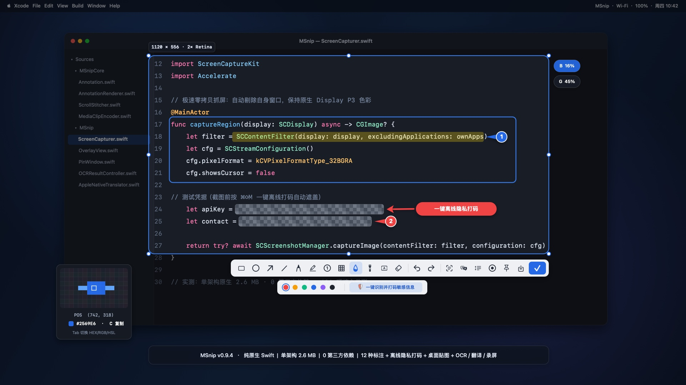
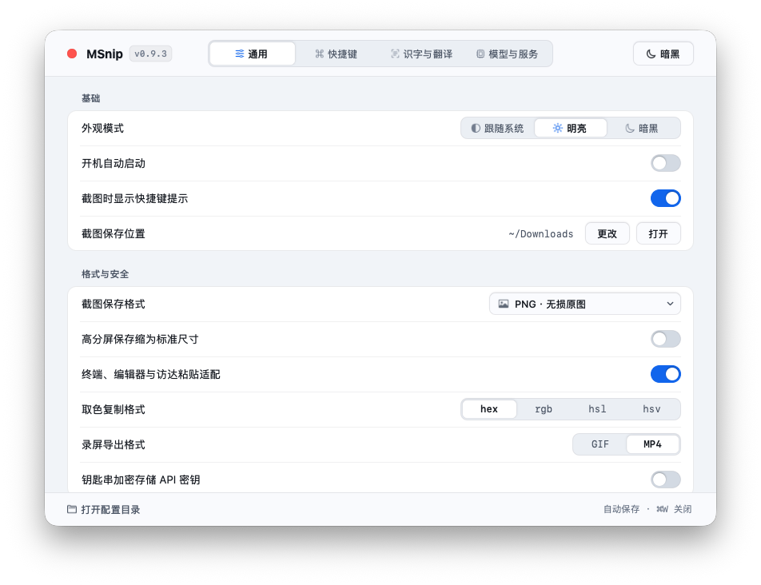

<div align="center">

# MSnip（麦截）

### 3 MB 以内的纯原生 macOS 截图 · 标注 · 贴图 · 录屏 · OCR / 翻译工具

**本机原生仅 `2.7 MB`（Zip `1.3 MB`）、零第三方依赖、待机 `0%` CPU、用完即清全屏位图——把 12 种标注、离线隐私自动打码、智能矩阵吸附、桌面贴图、顶边暂存架、多图拼接/PDF、纵横滚动长图、高帧率硬件录屏（含胶片帧无损裁剪）、多引擎 OCR / 公式与原位翻译全部装进一个极致轻量的纯原生 Swift 应用，源码公开、个人与非商用永久免费。**

<p align="center">
  <a href="https://github.com/xy-tuoren/MSnip/releases"></a>
  <a href="https://github.com/xy-tuoren/MSnip/actions/workflows/ci.yml"></a>
  <a href="https://github.com/xy-tuoren/MSnip/stargazers"></a>
  
  
  
  
  <a href="LICENSE"></a>
  <a href="https://linux.do/"></a>
</p>

**简体中文** · [English](README_EN.md)

**[核心优势](#-为什么选-msnip五大硬核优势) · [深度对比](#-与主流-macos-截图工具深度对比) · [30 秒上手](#-30-秒快速上手) · [性能红线](#-性能与体积红线实测口径) · [界面预览](#-界面与实景预览) · [快速安装](#-快速安装) · [常见问题](#-常见问题) · [许可协议](#-许可协议非商用公开源码)**

</div>

<br/>



*按下 `⌥A` 后的实景体验：0ms 冻结屏幕、防误吸智能矩阵识别、120Hz 跟手双层悬浮工具栏与提示气泡、一键离线打码 API Key / 手机号 / 邮箱、右上角实时调节圆角与外发光，以及零拷贝 15×7 GPU 像素放大镜。*

---

## 为什么选 MSnip？五大硬核优势

macOS 用户为了凑齐日常视觉效率，常常要在菜单栏同时常驻 3–4 款软件（截图 + 贴图 + 长图/录屏 + OCR/翻译），或者为闭源商业套件按年续费；而不少跨平台工具套着 Electron / Qt / 内嵌 `ffmpeg`，动辄 50–120+ MB 且常驻占用可观内存。

**MSnip v1.0.0 拒绝在「轻量」和「全能」之间做妥协**：零第三方依赖，100% 纯原生 Swift + macOS 系统框架编写，把一整套专业视觉工作流压缩进 **2.7 MB** 原生体积。

### 1. 极致轻量，一台顶四台（`2.7 MB` vs `50–120+ MB`）
- **原生应用仅 `2.7 MB`（Zip `1.3 MB`）**，体量只有同类主流工具的 **1/4 到 1/40**；完整覆盖「截图 + 12 种标注 + 离线打码 + 桌面贴图 + 顶边暂存架 + 拼图/PDF + 纵横长图 + 高帧率录屏/裁剪 + 6 引擎 OCR/表格/LaTeX + 原位翻译」。
- **待机 `0.0%` CPU、会话结束秒清全屏位图**：不常驻后台轮询线程，不捆绑 WebView 壳或 `ffmpeg`；截图/录屏/预览关闭即刻归零全屏 `CGImage`、切片缓存与临时文件。

### 2. 为开发者与 AI 编程工作流量身打造（同类工具普遍缺席）
- **终端 & AI IDE 智能贴路径**：复制截图后切回 Ghostty / iTerm2 / Terminal，或 VS Code / Cursor / Zed / JetBrains 内置终端（以及 Claude Code / Codex 等 CLI 助手）按 `⌘V`，**自动变为无空格临时 `.png` 路径**；切回微信 / Slack / 飞书 / 文档按 `⌘V` 仍是纯净原图，切回访达则直接粘贴文件。
- **本机离线一键隐私打码**：基于 macOS 原生 Vision 扫描选区内的 **API Key / JWT、邮箱、手机号、18 位身份证号、非环回 IPv4、银行卡号**，一键马赛克或高斯模糊遮盖，且支持 `⌘Z` 整体撤回，再也不怕发报错截图泄密。
- **表格一键还原 Markdown / TSV & LaTeX 公式识别**：截一张复杂表格直出标准 Markdown 或 Excel/Numbers 分列文本；数学公式支持视觉大模型 / SimpleTex / Mathpix 与离线原生 MathML 即时渲染 + KaTeX 精排。

### 3. 真正跟手、不乱吸的 120Hz 原生交互质感
- **抗干扰智能矩阵识别**：结合窗口快照 + 语义角色 AX 过滤 + **像素级四边闭合/极性一致性校验** + **高速扫屏速度阻尼**，彻底剔除浏览器 / Electron 隐形 `<div>` 容器与终端多行代码文本噪声；快速扫屏稳在整窗层级，减速即精准落位到可见卡片/按钮，滚轮或 `[` `]` 丝滑切层。
- **全链路 120Hz VSync 驱动**：截图工具栏悬停高亮、悬浮提示气泡、像素放大镜与自动吸附框均由硬件刷新率直推，彻底解决非激活置顶面板 hover 迟钝与原生 `toolTip` 被遮挡问题；状态栏菜单保持系统原生零延迟展开手感。

### 4. 高帧率硬件录屏 + 胶片帧无损裁剪，纵横长图双向全覆盖
- **MP4 / GIF 全规格录屏**：MP4 直通 VideoToolbox 硬件 H.264（支持原画 Retina 1:1、30/60/跟随屏幕高帧率、macOS 13+ 系统音频内录、点击波纹、按键 HUD、**录中实时红笔/激光笔标注**），录完可直接在内置**胶片帧实时追帧裁剪窗**里拖拽首尾毫秒级无损裁切；GIF 采用 **LZ4 磁盘流式暂存**，录长片段也不爆内存。
- **纵横双向滚动长截图**：支持纵向向下与横向向右拼接，自动剔除固定顶栏/底栏/静态侧边栏，支持 **`⌘Z` 撤回上一段**与失步自愈。

### 5. 透明可审计，隐私 100% 掌控在自己手里
- 截图软件持有 macOS 最高级别的「屏幕录制」权限。MSnip **全程公开全部 Swift 源码供审阅与自编译**，无账号登录、无遥测上报、无暗箱联网；截图、标注、打码、OCR、二维码扫描、长图、录屏及 macOS 15+ Apple 原生翻译全部本机离线完成。若你主动配置云端翻译 / OCR / 公式 API，密钥严格隔离存放在 `0600` 本地文件或 macOS 系统钥匙串中。

---

## 与主流 macOS 截图工具深度对比

> 基于各产品公开特性与常见版本客观整理，突出各自架构路线与能力边界差异。

| 能力维度 | macOS 自带 | Shottr | Snipaste | CleanShot X | PixPin | **MSnip（麦截）v1.0** |
| :--- | :---: | :---: | :---: | :---: | :---: | :---: |
| **源码与个人使用** | 系统内置 | 闭源 · 付费 Pro | 闭源 · 付费 Pro | 闭源 · $29 + 续费 | 闭源 · 会员制 | **源码公开可审计 · 个人/非商用永久免费** |
| **技术栈与依赖** | 系统内置 | 原生 Swift | Qt / C++ | 原生 Swift + 闭源组件 | Qt / C++ + 外挂引擎 | **100% 纯原生 Swift · 0 第三方依赖** |
| **应用体积** | 系统内置 | ~10 MB | ~55 MB | ~50+ MB | ~120+ MB | **原生 `2.7 MB`（双架构 `6.0 MB`）** |
| **智能矩阵识别** | 仅整窗 | 基础边缘 | 窗口 / 元素 | 仅整窗 | 窗口 / 元素 | **AX 语义 + 像素四边闭合校验 + 速度阻尼** |
| **标注与隐私打码** | 基础标注 | 丰富标注 | 丰富标注 | 丰富 + 手动打码 | 丰富标注 | **12 种标注 + 聚光灯 + 离线自动识别隐私打码** |
| **桌面贴图（Pin）** | 不支持 | 单图置顶 | 强贴图（基础框） | 基础置顶 | 强贴图 | **发光边 + 8 向缩放 + Live Text + 穿透 + 拖出文件** |
| **顶部暂存架 & 拼图/PDF** | 不支持 | 不支持 | 不支持 | 仅简单历史 | 不支持 | **98pt 紧凑暂存条 + 多图拼接（含二次标注）+ 合并 PDF** |
| **滚动长截图** | 不支持 | 仅纵向 | 不支持 | 仅纵向 | 纵 / 横向 | **纵 / 横双向 + 撤回上一段 + 剔除粘性/侧边栏** |
| **录屏与无损裁剪** | 基础录屏 | 不支持 | 不支持 | 付费支持 | GIF / 录屏 | **高帧率硬件 H.264 + 系统音频 + 录中画笔 + 胶片帧无损裁剪** |
| **OCR / 表格 / 翻译 / LaTeX** | 预览选字 | 离线 OCR | 不支持 | 离线 OCR | OCR + 贴图翻译 | **6 类 OCR + Markdown 表格 + 段落级原位/流式翻译 + LaTeX** |
| **终端 / AI IDE 智能贴路径** | 不支持 | 不支持 | 不支持 | 不支持 | 不支持 | **按前台应用自动切换（终端贴路径 / 聊天贴原图）** |
| **待机能耗与内存红线** | 系统进程 | 较轻 | 中等 | 较重 | 较重 | **待机 `0%` CPU · 退出会话秒清全屏位图** |

---

## 30 秒快速上手

安装打开后 MSnip 仅静默常驻在顶部菜单栏，不占 Dock 栏、无后台轮询：

1. **截图标注 + 终端/AI 编程秒贴路径**：按 **`⌥A`** 冻结屏幕 → 鼠标移动自动吸附真实窗口/卡片（滚轮或 `[` `]` 切层）→ 框选或单击锁定 → 双击选区完成复制。切回 **Terminal / Ghostty / Cursor / Claude Code / Codex** 按 `⌘V` 自动贴出无空格 `.png` 路径；切回 **微信 / 飞书 / 文档** 按 `⌘V` 直接贴原图。
2. **发报错截图前一键离线打码**：框选后点工具栏的**隐私打码图标**，本机 Vision 自动定位并遮盖 API Key、JWT、手机号、邮箱、身份证与 IPv4，误遮按 `⌘Z` 一步撤回。
3. **贴图对照 & 顶边暂存架**：截图后按 **`P`** 钉在桌面随时对照（支持 Live Text 划词、`P` 鼠标穿透、`⌘+拖拽` 当文件发出去）；鼠标抵住屏幕正顶边即可滑出 **98pt 顶部暂存架**，`⌘+单击` 多选多图直接进入拼图 / 合并 PDF 工作室。
4. **高帧率录屏 + 胶片帧无损裁剪**：按 **`⌥R`** 框选录屏区域，支持边录边用红笔/激光笔标注；MP4 录制结束点工具栏剪刀图标，拖动胶片缩略图首尾手柄即可实时追帧并毫秒级无损裁切。

---

## 性能与体积红线（实测口径）

| 指标 | 实测表现 | 工程实现说明 |
| :--- | :--- | :--- |
| **原生应用体积（`arm64`）** | **`2.7 MB`**（Zip **`1.3 MB`**） | `scripts/bundle.sh` 实测 `2,728 KB`（硬守门 `≤ 3.0 MiB`） |
| **双架构通用包（Universal）** | **`6.0 MB`**（Zip **`2.9 MB`**） | `arm64 + x86_64` 双切片通用二进制（GitHub Releases & Homebrew） |
| **应用图标（`AppIcon.icns`）** | **`68 KB`** | 纯 CoreGraphics 矢量绘制 + 5 滤镜最优 `zlib-9` + 8 切片标准 `sRGB` |
| **待机 CPU 占用** | **`0.0%`** | 纯事件驱动，无后台定时轮询 |
| **会话内存零驻留** | **用完即清** | 退出截图/录屏/预览立即释放全屏 `CGImage`、切片缓存、临时文件与 WebKit 子进程 |
| **覆盖层与工具栏刷新** | **120Hz 高刷满帧** | 硬件 VSync 直推 + 纯 GPU 静态遮罩层 + 局部脏矩形增量刷新 + 零拷贝像素放大镜 |
| **高帧率录屏编码** | **60 / 120 fps** | MP4 直通 VideoToolbox 硬件 H.264 零拷贝；GIF 采用 LZ4 磁盘流式暂存防爆内存 |
| **色彩与 Retina 精度** | **Display P3 原生** | 逻辑点交互与物理像素导出严格分离，全链路保留屏幕 ICC 色彩配置 |

**为什么能压在 `3 MB` 以内且不牺牲功能与稳定性？**
1. **零第三方依赖**：`Package.swift` 依赖为空，全部直调 macOS 原生 `AppKit`、`ScreenCaptureKit`、`Accelerate/vImage`、`Vision`、`VideoToolbox`、`AVFoundation` 与 `Translation`。
2. **全模块单单元 LLVM 极客优化**：Release 启用 `-Osize` + `-cross-module-optimization` + `-enable-single-module-llvm-emission` + 仅导出 `_main`，同时**完整保留 Swift 反射元数据**确保 SwiftUI / Translation / VisionKit 100% 稳定。
3. **纯矢量高压缩图标**：使用 [generate-icon.swift](scripts/generate-icon.swift) 直接程序化生成全分辨率锐利的 `68 KB` `sRGB` `.icns`，告别数百 KB 栅格冗余。

---

## 界面与实景预览

### 核心工作流全景（桌面贴图 · 顶边暂存架 · OCR / 翻译 / LaTeX · 开发者专属）


### 极客设置中心（真实运行窗口截图 · 4 标签零横向滚动条）

<p align="center">
  
</p>

*所有偏好收口于「通用 / 快捷键 / 识字与翻译 / 模型与服务」四栏，原生适配浅色与深色模式，修改即生效自动保存，支持密钥系统钥匙串加密与脱敏 JSON 一键迁移。*

---

## 核心功能一览

### 1. 精准截图、智能矩阵吸附与延时抓拍
- **防误吸智能多级吸附**：自动识别程序坞、菜单栏、窗口层、紧凑交互控件与四边闭合视觉卡片，过滤浏览器/Electron 隐形包装容器与终端文本噪声；高速扫屏稳在窗口层，减速即精准落位，滚轮或 `[` / `]` 在「控件 ↔ 区域 ↔ 窗口 ↔ 全屏」间顺滑切换（按 `W` 一键对齐底层窗口）。
- **自定义延时截图（`⌥W`，`1–60` 秒）**：悬浮倒计时圆环（点击立刻抓屏，`Esc` 取消），内置系统菜单防卡死保护，轻松捕获右键菜单与悬停态。
- **一键截取当前全屏（`⌥S`）**：截取鼠标所在显示器，默认动作可自由配置（仅复制 / 仅保存 / 复制并保存）。
- **纯净独立窗口（`F` / `⇧↩`）**：剥离背景杂物，导出带 macOS 原生透明柔和阴影的单窗图。
- **圆角裁切 & 外发光强度（`B` / `G`）**：选区右上角双圆钮支持拖拽或滚轮实时调节 `0%–100%` 圆角与外发光。
- **多格式导出与克制的速览反馈**：支持 `PNG / JPG / HEIC / AVIF / BMP / TIFF`、Retina `1×` 缩存与自定义文件名模板（如 `MSnip-{date}-{time}-{w}x{h}`）；普通复制静默完成零打扰，落盘保存与录屏完成后弹出半透明轻驻留速览卡方便一键打开或分享。

### 2. 12 种标注工具、聚光灯与离线一键隐私打码
- **标注全集**：矩形、椭圆、箭头、直线、贝塞尔画笔、智能荧光笔、自增步骤序号 `①②③`、马赛克、SIMD 高斯毛玻璃、**聚光灯高亮（Spotlight）**、圆角胶囊文字、分段橡皮擦。
- **离线一键打码**：本机 Vision 识别 API Key / JWT、邮箱、手机号、18 位身份证号、非环回 IPv4 与银行卡号并自动遮盖，`⌘Z` 一步撤回。
- **二次编辑、克隆与 100 步撤销**：点选任意标注拖控制柄微调；支持 **`⌘C` / `⌘V` 复制粘贴**与 **`⌘D` 原地克隆**（序号自动递增），100 步 CoW 快照撤销/重做栈。

### 3. 桌面贴图（Pin）、顶部轻暂存架（Shelf）与多图拼接 / PDF 工作室
- **顶部紧凑暂存条（MSnip Shelf）**：支持**悬停展开**（贴顶 `≤ 1.5pt` 停留 `0.55s` 防误触、拖文件到顶边 `80ms` 秒弹）、**快捷键切换**与**常驻显示**；`98pt` 紧凑高度，同屏展示多达 9 张卡片，支持点击复制、`✎` 二次标注、`⌘ + 单击` 按序多选拼图与拖出分享。菜单栏图标支持**左/右键原生零延迟展开菜单，`⌥ + 左键` 一键显隐暂存架**。
- **桌面贴图**：柔和白/蓝外发光边框、`0%–100%` 连续光晕滑条双向同步、8 向边角纯净缩放、原图 Live Text 划词、`⌘ + 拖拽` 直投 `.png` 文件、鼠标穿透对照（`P`）、多贴图 `8pt` 磁吸对齐，以及零遮挡图外悬浮条。
- **多图拼接与合并 PDF 工作室**：支持自由拖入/排序、**画布内直接二次标注**，提供**「拼成一张图」**（横/纵/2–4 列网格、画幅预设、间距/圆角/阴影/2D 色盘吸管/渐变/透明底色、序号与水印）与**「合并多页 PDF」**双模式。

### 4. 纵横滚动长截图（`⌥E` / `L`）与高帧率录屏 / 无损裁剪（`⌥R` / `V`）
- **纵横滚动长截图**：无损实时采样，自动剔除固定顶栏/底栏/静态侧边栏，支持**纵向向下 / 横向向右**双方向、**`⌘Z` 撤回上一段**与失步自愈。
- **高帧率 GIF / MP4 录屏与胶片帧裁剪**：MP4 支持 **标准 / 高清 / 原画 (Retina 1:1)**、**30 / 60 / 跟随屏幕高帧率**、**macOS 13+ 系统音频内录**、点击波纹、快捷键 HUD、**录中实时红笔/激光笔标注**；录后内置**带 10 槽胶片缩略图、实时追帧预览指针与时间气泡的 MP4 无损首尾裁剪窗**（支持空格播放、`Esc`/`⌘W` 退出、毫秒级 `Passthrough` 裁切）；GIF 支持 **轻巧 / 标准 / 高清** 三档。

### 5. 多引擎翻译、OCR（离线 + 云端 + 视觉大模型）与 LaTeX 公式（`⌥D` / `⌥F`）
- **段落级原位翻译 & 流式双栏翻译**：支持 **macOS 15+ Apple 原生离线翻译**，以及 **OpenAI Chat / OpenAI Responses (`/v1/responses`) / Anthropic Messages / Gemini Native** 四大协议（自动过滤推理思考块）与 DeepSeek / 智谱 / 通义 / 豆包 / Kimi / 腾讯 / 百度 / 有道 / DeepL / Ollama / 自定义中转主备容灾。
- **三模式识字与 6 类 OCR 引擎**：支持**原位划词 / 双栏对照 / 静默直拷**；除 **Apple 离线 Vision** 外支持**视觉大模型 / 百度 / 腾讯 / 有道 / 自定义 HTTP 通用适配**（兼容 Umi-OCR / PaddleOCR / RapidOCR），表格一键转 **Markdown / TSV**，内置静默二维码/条码识别。
- **LaTeX 公式识别**：支持视觉大模型 / SimpleTex / Mathpix / 离线基础识别，内置离线原生 WebKit MathML 即时渲染与在线 KaTeX 精排预览。

### 6. 命令行与 `msnip://` URL Scheme 联动
- 原生适配 Raycast / Alfred / Apple 快捷指令 / Shell 脚本：支持 `open msnip://capture`、`msnip://translate`、`msnip://ocr`、`msnip://silent-ocr`、`msnip://shelf`、`msnip://long`、`msnip://record`、`msnip://pin`、`msnip://settings`，以及 `MSnip --enter=ocr|shelf|long|video|pin` 单实例快传。出于安全考虑，外部触发的 `fullscreen` 不会静默截屏，而是打开截图覆盖层由你确认，防止其他进程借道 MSnip 的屏幕录制权限。

---

## 快速安装

### 系统要求
- **macOS 12.0 (Monterey) 及以上**（Apple Silicon `arm64` & Intel `x86_64`）
  - 实况文本划词（Live Text）、MP4 系统音频内录：macOS 13.0+
  - `ScreenCaptureKit` 极速静默抓屏：macOS 14.0+（macOS 12–13 自动回退）
  - Apple 原生离线翻译：macOS 15.0+
- **系统权限**：**屏幕录制**（必需，用于抓屏与录屏）；**辅助功能**（可选，用于控件吸附、IDE 内置终端识别及热键冲突接管）。

### 方式一：源码一键编译原生极致瘦身版（推荐，仅 `2.7 MB`）

需安装 Xcode Command Line Tools（`xcode-select --install`）：

```bash
git clone https://github.com/xy-tuoren/MSnip.git
cd MSnip
bash scripts/install.sh --rebuild
```

> [!TIP]
> 若经常拉取最新源码重编，先运行一次 `bash scripts/setup-cert.sh` 在本机钥匙串生成固定自签名证书，此后每次升级均无需在系统设置中重新授予「屏幕录制」与「辅助功能」权限。

### 方式二：GitHub Releases 直接下载（Universal 双架构 / 原生 arm64）

前往 **[GitHub Releases（最新版）](https://github.com/xy-tuoren/MSnip/releases/latest)** 下载：
- **通用双架构（Apple Silicon + Intel）**：`MSnip-v*-macOS.zip`（约 `2.9 MB`）
- **Apple Silicon (M1–M4) 原生极致轻量版**：`MSnip-v*-macOS-arm64.zip`（约 `1.3 MB`）

解压后拖入 `/Applications` 即可运行。首次打开如遇 macOS Gatekeeper 提示，执行一次清除隔离属性：

```bash
xattr -cr /Applications/MSnip.app
```

### 方式三：Homebrew Cask

```bash
brew tap xy-tuoren/msnip https://github.com/xy-tuoren/MSnip
brew install --cask msnip
```

> Homebrew Cask 会先校验 Release 包的 SHA256，再用 `xattr -cr` 自动清除隔离属性，开箱即用。

---

## 常见问题

<details>
<summary><strong>首次打开提示「已损坏，无法打开」或「无法验证开发者」？</strong></summary>

MSnip 为独立开发者免费项目，目前使用 ad-hoc 签名而未购置 Apple 年费公证证书，macOS 会给浏览器下载的 Zip 打上 `com.apple.quarantine` 隔离标记。终端执行一次 `xattr -cr /Applications/MSnip.app` 即可正常打开；如果你使用 Homebrew Cask 安装或本地源码编译（`bash scripts/install.sh --rebuild`），则全程不会遇到该提示。

</details>

<details>
<summary><strong>以后升级版本，需要重新勾选「屏幕录制 / 辅助功能」权限吗？</strong></summary>

日常使用或重启电脑不会掉权限。如果你经常拉取最新源码自行重编，建议先运行一次 `bash scripts/setup-cert.sh` 在本机钥匙串生成固定自签名证书——此后每次 `bash scripts/install.sh --rebuild` 升级都将保持同一证书指纹，**永久免重授 TCC 系统权限**。

</details>

<details>
<summary><strong>会偷偷联网、上传我的截图或采集遥测吗？</strong></summary>

**绝不。** MSnip 100% 源码公开且零第三方 SDK，无账号系统、无埋点遥测、无后台心跳上报。截图、标注、离线隐私打码、Apple Vision OCR、二维码扫描、长图拼接、录屏裁剪及 macOS 15+ Apple 原生翻译全部本机离线运行。仅当你主动在「设置 → 模型与服务」中配置了第三方云翻译 / 云 OCR / LaTeX 接口并触发对应功能时，请求才会直接发往你填写的接口地址，且 API 密钥仅存于 `0600` 本地文件或 macOS 系统钥匙串。唯一的例外是公式识别结果窗口：打开时预览区会从 jsDelivr CDN 下载固定版本、带 SRI 完整性校验的 KaTeX 排版脚本，只下载静态文件、不上传任何公式内容；无网络时自动退回内置的离线 MathML 渲染。

</details>

<details>
<summary><strong>为什么原生体积能压到 2.7 MB，和其他几十上百 MB 的工具差在哪？</strong></summary>

主流跨平台截图工具往往捆绑 Electron / Qt 运行时、Chromium 渲染壳或完整 `ffmpeg` 二进制。MSnip 放弃跨平台包袱，纯原生 Swift 直调 macOS 内置 `AppKit`、`ScreenCaptureKit`、`Accelerate/vImage`、`Vision`、`VideoToolbox` 与 `Translation`，再结合单 LLVM 单元 `-Osize` 裁剪与 `68 KB` 纯矢量图标，在不牺牲任何核心能力的前提下将原生包压到 `2.7 MB`。

</details>

<details>
<summary><strong>为什么从 MIT 切换为 PolyForm Noncommercial 1.0.0 协议？</strong></summary>

为了让每一位个人用户与开发者都能放心审阅全部源码、免费自用与自行编译，同时防止项目代码被直接闭源换皮、打包售卖或未经授权集成到付费商业产品中。个人学习、研究与非商业使用永久免费；如需商业授权请通过 Issue 联系作者。

</details>

---

## 快捷键速查

### 全局热键（内置 4 套预设 + 冲突扫描与自由录制）

| 动作 | 左手双键（默认） | 数字双键 | F 键单键 | 经典三键 |
| :--- | :---: | :---: | :---: | :---: |
| **区域截图** | `⌥A` | `⌃1` | `F1` | `⌃⌘A` |
| **桌面贴图** | `⌥T` | `⌃2` | `F2` | `⌃⌘T` |
| **截取当前全屏** | `⌥S` | `⌃3` | `F3` | `⌃⌘S` |
| **截图翻译** | `⌥D` | `⌃4` | `F4` | `⌃⌘D` |
| **滚动长截图** | `⌥E` | `⌃5` | `F5` | `⌃⌘E` |
| **区域录屏 (GIF/MP4)** | `⌥R` | `⌃6` | `F6` | `⌃⌘R` |
| **延时截图** | `⌥W` | `⌃7` | `F7` | `⌃⌘W` |
| **快捷识字 (OCR)** | `⌥F` | `⌃8` | `F8` | `⌃⌘G` |
| **顶部暂存架** | `⌥Q` | `⌃9` | `F9` | `⌃⌘K` |
| 公式识别 / 显隐贴图 / 重截上次选区 | 可选自由绑定 | 可选自由绑定 | 可选自由绑定 | 可选自由绑定 |

<details>
<summary><b>展开查看：截图覆盖层与桌面贴图（Pin）全部快捷键</b></summary>

#### 截图覆盖层内（24 项单键均可在设置中自定义）

| 按键 / 手势 | 功能 |
| :--- | :--- |
| 移动鼠标 / 滚轮 / `[` `]` | 防误吸智能吸附并在「控件 ↔ 区域 ↔ 窗口 ↔ 全屏」间切换 |
| `Enter` / `C` / 双击选区 | 复制高清图到剪贴板并完成（`⇧⌘C` / `⌥↩` 强制带临时文件路径） |
| `S` / `⌘S`（配 `⇧` 另存为） | 一键直存默认目录 / 弹出另存为面板 |
| `P` | 贴到桌面（Pin） |
| `F` / `⇧↩`（配 `⌥` 独立窗） | 对齐底层窗口 / 抓取独立纯净阴影窗口 |
| `B` / `G`（或右上角圆钮滚轮） | 调节圆角裁切比例 / 调节发光边强度（配 `⌥` 归零） |
| `1`–`9` / `R` `A` `D` `W` `N` `M` `E` | 矩形/椭圆、箭头、画笔/荧光笔、文字、序号、马赛克/模糊、聚光灯、橡皮擦 |
| `T` / `⇧T` / `Y` | 原位识字 / 公式识别 / 段落级原位翻译（配 `⌥` 切双栏窗） |
| `L` / `V` | 滚动长截图 / 选区录屏模式 |
| `Z` / `X` / `I` / `Tab` | 像素卡尺四向测距 / 复制坐标 / 吸管取色 / 切换色值格式 |

#### 桌面贴图窗口（Pin）内

| 按键 / 手势 | 功能 |
| :--- | :--- |
| 拖动任意 4 角或 4 边 | 8 向等比缩放（仅悬停边角显微指示与原生缩放光标） |
| 滚轮 / `⌘+滚轮` / `⌥+滚轮` | 缩放大小 / 调节透明度 / 实时调节外发光边强度 |
| 划词 / 空白拖拽 / `⌥+拖拽` | 原图 Live Text 直接划词；拖动自动 `8pt` 磁吸对齐（`⌥` 临时禁吸） |
| `⌘ + 左键拖拽` | 作为高清 `.png` 文件直接拖入聊天窗、浏览器或访达 |
| `⌘S` / `⇧⌘S` / 点击悬浮条 `↓` | 一键直存默认目录 / 另存为 |
| `E` / `C` / `R` / `H` / `P` | 二次标注 / 二次裁剪 / 顺时针旋转 90° / 水平翻转 / 鼠标穿透对照 |
| `T` / `Y` / `Esc` 或双击空白 | 提取文字 / 翻译文字 / 关闭当前贴图 |

</details>

---

## 工程架构与测试

MSnip 在代码层面坚持内聚模块化与零第三方依赖：全库共 **111 个 `.swift` 文件**，CI 强制守门单文件 `≤ 800` 行，核心算法与 AppKit 界面层彻底解耦，并自带零外部框架依赖的自动化单测套件（**420 项核心断言**）。

```bash
swift build                             # Debug 编译检查（0 Swift 警告）
swift run MSnipTests                    # 运行全部 420 项核心单元测试
bash scripts/bundle.sh                  # 构建本机单架构极致瘦身包（2.7 MB）
bash scripts/bundle.sh --universal      # 构建双架构通用二进制（发版用，6.0 MB）
```

```text
Sources/
├── MSnipCore/      # 纯算法与数据模型层（几何、四边闭合视觉探测、12 种标注、vImage SIMD 渲染、长图拼接、GIF/MP4 编码、OCR/敏感字段探测、热键与凭据仓）
├── MSnip/          # macOS AppKit 平台层（菜单栏、ScreenCaptureKit 抓屏、120Hz 冻结覆盖层、贴图池、暂存架、拼图、录屏与裁剪、OCR/LaTeX、翻译与设置）
└── MSnipTests/     # 零外部依赖自动化单测套件（420 项核心断言）
scripts/
├── bundle.sh       # ≤800 行护栏、Release -Osize 单单元 LLVM 构建、体积红线守门与签名打包
├── generate-icon.swift  # 零依赖纯矢量 sRGB AppIcon.icns 生成器（68 KB）
├── install.sh      # 一键安装并启动至 /Applications/MSnip.app
└── setup-cert.sh   # 创建本机固定代码签名证书（升级免重授 TCC 权限）
```

---

<div align="center">

### Star History

<a href="https://www.star-history.com/#xy-tuoren/MSnip&Date">
 <picture>
   <source media="(prefers-color-scheme: dark)" srcset="https://api.star-history.com/svg?repos=xy-tuoren/MSnip&type=Date&theme=dark" />
   <source media="(prefers-color-scheme: light)" srcset="https://api.star-history.com/svg?repos=xy-tuoren/MSnip&type=Date" />
   
 </picture>
</a>

</div>

---

## 隐私声明

MSnip 是本地优先的桌面效率工具：无账号、无遥测、无广告，不产生任何后台联网请求。对外请求只有两种：你主动配置并调用云端 OCR / 翻译 / LaTeX 服务时，直连你指定的服务接口；打开公式识别结果窗口时，从 jsDelivr CDN 下载固定版本、带 SRI 完整性校验的 KaTeX 排版脚本（不上传任何公式内容）。为便于排查问题，MSnip 会在本机 `~/Library/Logs/MSnip` 记录运行事件与错误码（不含截图、识别或翻译内容、密钥与接口地址，总量不超过约 1 MB），只有你在设置里点击「复制诊断信息」时才会被复制出来。

## 鸣谢

感谢 **[LINUX DO](https://linux.do/)** 社区与各位佬友的反馈、建议与支持，也感谢 macOS 原生效率工具生态中众多优秀作品带来的启发。

[](https://linux.do/)

## 许可协议（非商用公开源码）

本项目采用 **[PolyForm Noncommercial License 1.0.0](LICENSE)**（SPDX: `PolyForm-Noncommercial-1.0.0`）协议公开源码：

- **允许**：个人学习、研究、非商业用途的免费使用、审阅源码、自编译以及非商业二次修改与分享（分发时必须保留原始版权声明与协议文本）。
- **禁止**：未经作者书面授权，**禁止任何形式的商业用途**（包括但不限于：直接或打包售卖、闭源/换皮二次分发、集成至付费软件或商业服务中）。
- **商业授权**：如需企业商用、二次商业分发或定制合作，请通过 [GitHub Issues](https://github.com/xy-tuoren/MSnip/issues) 联系作者获取书面商业授权。
