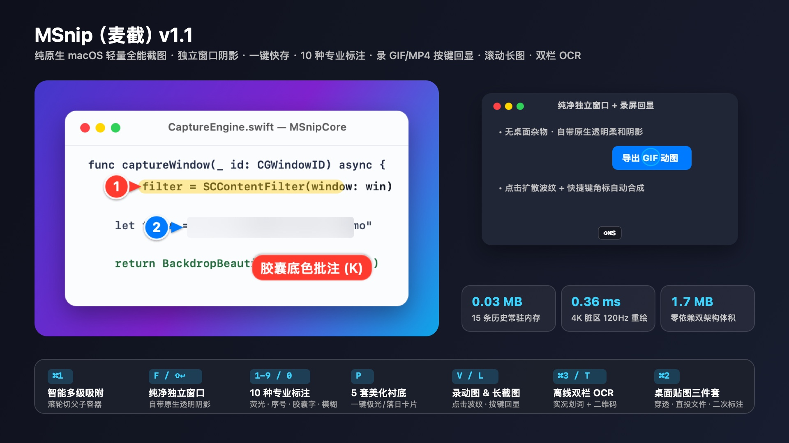

<div align="center">

# MSnip `v0.9.0`

**Ultra-lightweight, zero-dependency, pure-native macOS screenshot, annotation, pinning, scrolling capture, high-FPS screen recording, offline OCR/LaTeX, and in-place translation utility.**

[简体中文](README.md) · [English](README_EN.md)

[](https://github.com/xy-tuoren/MSnip)
[](Package.swift)
[](Package.swift)
[](scripts/bundle.sh)
[](LICENSE)

</div>

<br/>



---

## Why MSnip?

- **100% Pure Native, Zero Third-Party Dependencies**: Built strictly on Apple system frameworks (`Swift + AppKit + CoreGraphics + Accelerate + ScreenCaptureKit + VisionKit + Vision + Translation + AVFoundation + VideoToolbox + ImageIO`). Empty `dependencies` in `Package.swift`, no Electron, no WebView shell, no bundled `ffmpeg`. Final `.app` bundle is only **~3.3 MB** with **0% idle CPU**.
- **120Hz Responsive & Color-Accurate**: Static GPU `CALayer` frozen overlay, zero-allocation `CGImage.cropping` pixel loupe, and full native Display P3 / ICC color profile preservation from capture to export. Every `.swift` source file strictly obeys a `≤ 300` line architectural limit.
- **Privacy-First & Offline-Capable**: Capturing, annotation, Smart Auto-Redact, Vision OCR, table extraction, QR/barcode scanning, scrolling capture, GIF/MP4 recording, and macOS 15+ Apple native translation all run **100% locally**. Optional cloud translation/formula API keys are isolated in `0600` local files or macOS Keychain.

---

## Key Features

### 1. Precision Capture, Custom Delay & Instant Fullscreen
- **3-Tier Auto-Snap Detection**: Pre-indexed Dock & Menu Bar + Window Z-order + batched Accessibility hierarchy + closed-edge pixel visual fallback. Scroll the wheel or press `[` / `]` before locking to step smoothly between *UI element ↔ parent container ↔ full window*.
- **Custom Delayed Capture (`⌥W`, `1–60s`)**: Floating countdown ring (click to capture immediately; press `Esc` or the same hotkey to cancel) with modal-menu focus guard so open dropdown menus and hover states are captured cleanly without freezing.
- **Instant Fullscreen Capture (`⌥S`)**: Zero-latency capture of the display under the cursor with configurable default action (**Copy / Save / Copy & Save**); hold `⌥` when clicking from the menu bar to force quick-save.
- **Isolated Clean Window Capture (`F` / `⇧↩`)**: Captures a single window via `SCContentFilter(desktopIndependentWindow:)` with desktop clutter removed and native transparent drop shadow.
- **Corner Radius & Luminous Glow Sliders (`B` / `G`)**: Top-right side pills let you drag or mouse-scroll `0%–100%` rounded corners and soft luminous outer glow with live preview.
- **Multi-Format Export & Custom Filename Templates**: Hardware-probed `PNG / JPG / HEIC / AVIF / BMP / TIFF`, Retina `1×` downscale option for saved files, customizable filename templates (`{date} {time} {w} {h}` with live preview), and optional subtle feedback sound.
- **Smart Terminal / IDE / Finder Paste Adaptation**: Automatically pastes a space-free temporary `.png` file path into standalone terminals and built-in terminals (VS Code / Cursor / Zed / JetBrains), pastes files in Finder, and preserves clean raw images in chat/design apps (`⇧⌘C` / `⌥↩` forces path projection anytime).

### 2. 12 Annotation Tools, Offline Auto-Redact & Spotlight
- **Complete Toolkit**: Rectangle, Ellipse, anti-clipping Arrow, Line, Bézier Pen, Highlighter, auto-incrementing Step badges `①②③`, zero-alloc Mosaic, `vImage` SIMD Gaussian Blur, **Spotlight highlight**, Capsule Text, and segmented Eraser.
- **1-Click Offline Auto-Redact**: Uses on-device Vision OCR + pattern detection to mask API keys/JWTs, emails, phone numbers, 18-digit IDs, non-loopback IPv4 addresses, and bank cards in a single undoable transaction (`⌘Z`).
- **Interactive Post-Edit Handles**: Select any annotation to drag 4-corner resize handles, arrow/line endpoints, or step badge tails (hold `⇧` for aspect/15° snap), backed by a 100-step Copy-on-Write Undo/Redo stack.

### 3. Desktop Pin Workflow
- **Soft Luminous Outer Glow**: Subtle white outer halo by default (crisp separation on both dark and light desktops) that smoothly lights up into a soft blue outer glow on hover or focus. Fine-tune glow strength live on any pin with `⌥ + Scroll`.
- **8-Way Corner & Edge Resizing**: Completely clean at rest; hovering any of the 4 corners or 4 edges reveals a minimalist handle with native macOS `frameResize` cursors and aspect-locked resizing with a live size/zoom pill.
- **Multi-Image Comparison Collage & Auto-Fit**: Stitch the latest 2–4 original screenshots horizontally or vertically right from *Recent Captures* (previous collages are automatically tagged and excluded to prevent nesting). Oversized collages and long captures automatically scale to fit comfortably within screen bounds while preserving 100% full-resolution pixels underneath.
- **Floating Hover Bar & Gestures**: `[ ✥ Drag | ✎ Annotate | OCR | Translate | Copy | ↓ Save | ✕ Close ]` outside the image frame; native Live Text selection directly on the pin, `⌘ + Drag` out as a `.png` file, 1-click `↓` quick-save (`⇧ + Click` Save As), interactive Crop (`C`), 90° Rotate (`R`), Horizontal Flip (`H`), Click-Through Ghost Mode (`P`), and `8pt` magnetic snapping to screen edges and sibling pins (`⌥` disables snap).

### 4. Vertical & Horizontal Scrolling Capture (`⌥E` / `L`)
- 60Hz `32BGRA` lossless capture with sticky header/footer and static sidebar rejection, supporting both **Vertical Down** and **Horizontal Right** modes, **`⌘Z` undo last stitch**, automatic desync recovery, and 1-click handoff to Pin Annotation.

### 5. High-FPS Region Recording — GIF & MP4 (`⌥R` / `V`)
- **Native Refresh Rate & 3 Quality Tiers**: MP4 supports **Standard (`≤1280px`) / HD (`≤1920px`) / Original (Retina 1:1)** and **30fps / 60fps / Native Hz (up to 120fps on ProMotion displays)** with FPS-adaptive bitrate; GIF supports **Compact (`720px`) / Standard (`960px`) / HD (`1280px`)** via LZ4 disk spooling for near-zero memory overhead.
- **Zero-Copy Hardware Pipeline + System Audio + Quick Trim**: Direct `CVPixelBuffer` H.264 hardware encoding, **macOS 13+ native AAC system audio capture**, click ripples, modifier key HUD, **live laser/pen drawing during recording**, and lossless MP4 head/tail trimming.

### 6. Offline OCR, Table Extraction, QR/Barcode, LaTeX & Multi-Engine Translation (`⌥F` / `⌥D`)
- **In-Place Live Text & Dual-Pane OCR**: Select text directly inside the frozen overlay or open the dual-pane OCR window; structured multi-column tables can be copied as **Markdown** or **TSV** (hold `⌥` for direct Excel/Numbers paste).
- **Silent QR & Barcode Detection**: Automatically scans locked selections in the background and offers 1-click Open URL / Copy Value.
- **Paragraph In-Place & Streaming Translation**: Natural paragraph grouping with CoreText multi-line in-place rendering (hold to peek original; right-click to switch target language in place). Supports **macOS 15+ Apple Offline Translation**, plus OpenAI, Claude, Gemini, DeepSeek, Tencent, Baidu, Youdao, DeepL, and custom Webhooks with primary/fallback failover.
- **Multi-Engine LaTeX Formula Recognition**: Vision LLMs, SimpleTex, and Mathpix with built-in KaTeX live preview.

### 7. Unified Settings Center (Dark / Light / System)
- Clean 3-tab interface (*General / Shortcuts / Translation*) with 11 customizable global hotkeys + 24 canvas single-key bindings, live system/third-party conflict scanner, optional `CGEventTap` priority takeover, secret-stripped JSON config import/export, and 1-click diagnostic report export.

---

## Requirements

- **OS**: macOS 12.0 (Monterey) or later (Apple Silicon `arm64` & Intel `x86_64`)
  - Live Text on overlays & pins: macOS 13.0+
  - MP4 native system audio capture: macOS 13.0+
  - `ScreenCaptureKit` fast silent capture: macOS 14.0+ (automatic fallback on macOS 12–13)
  - Apple native offline translation: macOS 15.0+
- **Permissions**:
  - **Screen Recording** (Required): Capturing displays and recording screen regions.
  - **Accessibility** (Optional): Sub-millisecond UI element snapping, IDE terminal focus detection, and priority hotkey takeover.

---

## Installation & Build

### Option 1: Build & Install from Source to `/Applications` (Recommended)

Requires Xcode Command Line Tools (`xcode-select --install`):

```bash
git clone https://github.com/xy-tuoren/MSnip.git
cd MSnip
bash scripts/install.sh --rebuild
```

> [!TIP]
> If you rebuild from source frequently, run `bash scripts/setup-cert.sh` once to create a persistent local signing certificate in your Keychain — future rebuilds keep macOS Screen Recording and Accessibility permissions intact without re-granting.

### Option 2: Homebrew Cask

```bash
brew tap xy-tuoren/msnip https://github.com/xy-tuoren/MSnip
brew install --cask msnip
```

### Run Automated Test Suite

```bash
# Runs all 326 zero-dependency core unit test assertions
swift run MSnipTests
```

---

## Keyboard Shortcuts Reference

### Global Hotkeys (4 Built-in Presets + Full Custom Recording)

| Action | Left-Hand (Default) | Number Keys | Function Keys | Classic 3-Key |
| :--- | :---: | :---: | :---: | :---: |
| **Area Capture** | `⌥A` | `⌃1` | `F1` | `⌃⌘A` |
| **Pin to Desktop** | `⌥T` | `⌃2` | `F2` | `⌃⌘T` |
| **Capture Fullscreen** | `⌥S` | `⌃3` | `F3` | `⌃⌘S` |
| **Translate Selection** | `⌥D` | `⌃4` | `F4` | `⌃⌘D` |
| **Scrolling Long Capture** | `⌥E` | `⌃5` | `F5` | `⌃⌘E` |
| **Region Recording (GIF/MP4)** | `⌥R` | `⌃6` | `F6` | `⌃⌘R` |
| **Delayed Capture** | `⌥W` | `⌃7` | `F7` | `⌃⌘W` |
| **Quick OCR** | `⌥F` | `⌃8` | `F8` | `⌃⌘G` |
| LaTeX / Toggle Pins / Repeat Last Area | Optional | Optional | Optional | Optional |

### Inside Capture Overlay (All 24 Single Keys Customizable)

| Key / Gesture | Action |
| :--- | :--- |
| Move / Scroll / `[` `]` | 3-tier auto-snap between UI element, parent container & window |
| `Enter` / `C` / Double-Click | Copy image to clipboard (`⇧⌘C` / `⌥↩` forces temporary file path) |
| `S` / `⌘S` (`⇧` for Save As) | Quick-save to default folder / Save As dialog |
| `P` | Pin selection to desktop |
| `F` / `⇧↩` (`⌥` isolated window) | Snap to window / capture isolated window with native shadow |
| `B` / `G` (or scroll side pills) | Adjust corner radius / luminous glow strength (`⌥` resets to `0%`) |
| `1`–`9` / `R` `A` `D` `W` `N` `M` `E` | Rect/Ellipse, Arrow, Pen/Highlighter, Text, Step, Mosaic/Blur, Spotlight, Eraser |
| `T` / `⇧T` / `Y` | In-place OCR / LaTeX Formula / Paragraph In-Place Translation (`⌥` dual-pane) |
| `L` / `V` | Scrolling Capture / Region Recording mode |
| `Z` / `X` / `I` / `Tab` | 4-way Pixel Caliper / Copy Coordinates / Eyedropper / Cycle Color Format |

### Inside Desktop Pin Window

| Key / Gesture | Action |
| :--- | :--- |
| Drag any of 4 corners or 4 edges | 8-way aspect-locked resize with native macOS resize cursors |
| Scroll / `⌘+Scroll` / `⌥+Scroll` | Zoom / Adjust opacity / Tune luminous outer glow strength |
| Select text / Drag / `⌥+Drag` | Live Text selection; `8pt` magnetic snap to edges & sibling pins (`⌥` disables) |
| `⌘ + Left-Drag` | Drag out as a high-DPI `.png` file into chat, browser, or Finder |
| `⌘S` / `⇧⌘S` / Hover Bar `↓` | Quick-save to default folder / Save As (`⇧ + Click`) |
| `E` / `C` / `R` / `H` / `P` | Annotate / Crop / Rotate 90° CW / Flip Horizontal / Click-Through Ghost Mode |
| `T` / `Y` / `Esc` or Double-Click | Extract Text / Translate Text / Close Pin |

---

## Project Architecture

```text
Sources/
├── MSnipCore/      # Pure algorithms & models (geometry, annotations, vImage renderer, scroll stitcher, GIF/MP4 encoder, OCR formatters, hotkey conflict engine, credential vault)
├── MSnip/          # macOS AppKit layer (menu bar, ScreenCaptureKit capture, frozen overlay, pin pool, recorder, OCR/LaTeX, translation & geek settings UI)
└── MSnipTests/     # Zero-dependency automated test suite (326 assertions)
scripts/
├── bundle.sh       # <=300-line gate, Release -Osize build, vector .icns icon generator & code signing
├── install.sh      # One-command install & launch to /Applications/MSnip.app
└── setup-cert.sh   # Local persistent signing certificate helper (keeps TCC permissions across rebuilds)
```

---

## License

[MIT License](LICENSE)
